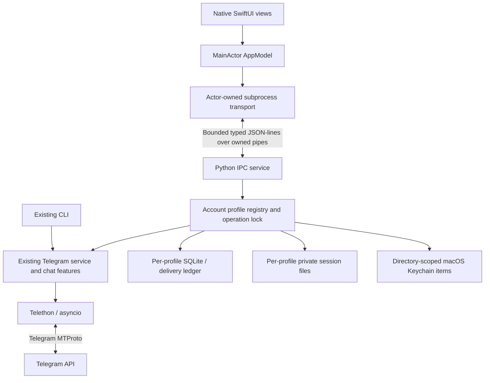

<div align="center">
  
  <h1>Telegram Manager</h1>
  <p><strong>Your Telegram workspace. Native to macOS. Deliberate by design.</strong></p>
  <p>Manage account profiles, browse conversations, inspect groups, and compose messages with explicit delivery controls.</p>
  <p>
    
    
    
    
    
  </p>
  <p><a href="#quick-start">Build &amp; launch</a> · <a href="docs/USER_GUIDE.md">User guide</a> · <a href="docs/ARCHITECTURE.md">Architecture</a> · <a href="docs/VALIDATION.md">Verification</a></p>
</div>

> **Development preview — v0.3.0.** This is a real SwiftUI/AppKit application with a Python backend, not a web wrapper. Local builds require the checkout's Python environment. Interactive launch and screenshot validation have encountered execution-environment blockers; compilation alone is not a verified desktop launch. There is no verified standalone installer or distributable release yet.

## A workspace with clear boundaries

Telegram Manager extends an existing permission-aware CLI into a native desktop app. The Python service remains responsible for Telegram authentication, SQLite persistence, account identity and delivery safety. The CLI remains available for maintenance.

| Workspace | Implemented capabilities |
| --- | --- |
| Accounts | Separate session/database/settings/Keychain namespaces; explicit switching and connection controls |
| Groups | Lightweight discovery, cached search/filter/sort, metadata freshness, bounded permission inspections |
| Conversations | Explicit dialog refresh, paginated recent messages, Saved Messages and Unicode text |
| Composition | Multiline editor, UTF-8 import, local drafts, previews and exact destination confirmation |
| Delivery | Managed-group approval, fresh permission checks, account verification, persistent deduplication and history |
| macOS | Native navigation and controls, semantic colors, light/dark/system appearance, selective Liquid Glass on macOS 26 |
| Storage | Private local files, account binding, SQLite backup and sanitized diagnostics |

**Technical text-posting permission does not imply permission to advertise or send unsolicited messages.** Newly discovered groups are never automatically approved or messaged.

## Backend connection and recovery

The app now explicitly owns one managed Python process. Ordinary requests never spawn replacements; Retry Connection waits for the old owned child to exit before starting one replacement. A single workspace window and shared settings model prevent competing window-owned backends.

If **Another instance is running** appears, use **View Diagnostics** and quit the known competing CLI/app before retrying. The exact owner of the reported real-world conflict could not be inspected in the managed environment. Never delete `manager.lock`, sessions or databases to suppress the error. See [backend lifecycle and safe recovery](docs/BACKEND_LIFECYCLE.md).

## Screenshots and visual evidence

No application screenshots or animated demonstrations are published here yet. Genuine graphical capture has not succeeded in the managed development environment; there are no generated mockups presented as screenshots.

The [UI validation report](docs/UI_VALIDATION.md) records launch attempts, executable UI tests, screenshot commands and unverified screens. Capture only synthetic fixtures, never real credentials or private conversations. Accepted screenshots belong under `docs/assets/screenshots/`; short genuine recordings belong under `docs/assets/demos/`.

## Multiple accounts

The original installation stays in place. Additional profiles use separate private directories rather than reusing the original session or resetting its account binding. Telegram's verified numeric account ID identifies account data; names and phone numbers do not.

- Add another profile through **Accounts**, then complete authentication in the app.
- Switch accounts explicitly. Cached data loads without an automatic discovery scan.
- Drafts, approved destinations, histories and cooldowns stay with their original account.
- Switching invalidates previews; a send cannot inherit another account's confirmation.
- Disconnect preserves authorization. Remote logout and local removal are separate, confirmed actions.

See [multi-account storage and lifecycle](docs/MULTI_ACCOUNT.md) for exact behavior, legacy-profile protections and limitations. Background Telegram work is conservative and sequential; inactive accounts are not continuously polled.

## Groups and permissions

Discovery retrieves basic joined-dialog metadata first, including archived groups. It excludes broadcast channels and migrated duplicates from managed messaging destinations. Detailed permissions, available slow mode and visible bot metadata are fetched only through explicit inspections or fresh pre-send checks.

**Allowed**, **Denied** and **Unknown** describe available Telegram evidence. Unknown fields and hidden moderation policies are reported honestly. A missing optional field does not prove that posting is forbidden—or safe.

Inspection batches are bounded and cancellable. Telegram FloodWait pauses work, saves progress and persists the deadline. The app does not evade limits or immediately retry. See the [CLI/cache reference](docs/CLI_GUIDE.md) and [user guide](docs/USER_GUIDE.md).

## Conversations and messages

The chat browser supports private dialogs, groups, channels and Saved Messages. Reading a conversation explicitly loads a bounded page of history; it does not download entire histories. Local search and explicit remote search are distinct operations.

Personal text sends require the active account, a selected cached conversation, preview and exact confirmation. Managed groups retain the stricter approved-destination and fresh-permission workflow. Each send reserves a persistent delivery record before submission. Lost connections and uncertain outcomes are never automatically replayed.

Per-conversation drafts and local labels are account-scoped. Attachment download is explicit, bounded to known-size files up to 64 MiB, cancellable and non-overwriting. File upload, edit/delete/forward workflows and complete media previews are not represented as completed features.

## Quick start

### Requirements

- Apple Silicon Mac; deployment target macOS 14+, with selective Liquid Glass on macOS 26+.
- Xcode and its macOS SDK for source builds.
- Python 3.13+ and the declared Telethon dependency in this checkout's `.venv`.
- Your own Telegram API application credentials for authentication.

### Build from source

```bash
git clone https://github.com/NipunChamodya/Telegrame-automator.git
cd Telegrame-automator
python3 -m venv .venv
.venv/bin/python -m pip install -e '.[dev]'
./macos/build.sh
open macos/build/Build/Products/Debug/TelegramManager.app
```

For the existing checkout:

```bash
cd ~/Desktop/TelegramManager
./macos/build.sh
open macos/build/Build/Products/Debug/TelegramManager.app
```

Quit the CLI before opening the desktop app. An exclusive lock protects each shared session/database. The GUI starts its Python subprocess itself; do not start the CLI as a prerequisite.

**Source build ≠ standalone release.** The local `.app` uses this checkout's virtual environment. A portable embedded runtime, release signing/notarization and clean-Mac acceptance testing remain required. No download button or installer is advertised.

<details>
<summary>CLI maintenance and Release builds</summary>

```bash
python3 main.py
./macos/build.sh Release
open macos/build/Build/Products/Release/TelegramManager.app
```

The CLI retains guided dependency/setup checks and never installs packages globally without approval. See [CLI_GUIDE.md](docs/CLI_GUIDE.md) for environment variables, commands, cache policies and recovery.

</details>

## Connect Telegram

1. Open the app and choose **Connect** or **Add Account**.
2. Obtain an API ID and API hash from [Telegram's official developer portal](https://my.telegram.org), under **API development tools**. The app explains the fields; API hash input is secret.
3. Enter your phone number in international format, such as `+947XXXXXXXX` for a Sri Lankan mobile number.
4. Enter the login code delivered by Telegram. The app does not promise a specific delivery channel.
5. Enter your two-step verification password if Telegram requests it.
6. Confirm the identity returned by Telegram before binding the profile.

Existing sessions are reused where possible. No destination is approved and no message is sent during setup.

| Action | Meaning |
| --- | --- |
| Disconnect | Close the connection; retain session and cached data |
| Log Out | Explicitly ask Telegram to invalidate this session; report failures honestly |
| Remove local data | Separately confirmed removal of the selected supported profile's local data; does not promise remote logout |

Treat `account.session` as an authentication credential. Never share it, put it in Git, or include it in screenshots. See [USER_GUIDE.md](docs/USER_GUIDE.md) for walkthroughs and recovery.

## Architecture



There is no HTTP listener, Electron, browser-based UI or separate Swift Telegram implementation. See [ARCHITECTURE.md](docs/ARCHITECTURE.md), [IPC.md](docs/IPC.md) and [MULTI_ACCOUNT.md](docs/MULTI_ACCOUNT.md).

| Technology | Role |
| --- | --- |
| Swift / SwiftUI / AppKit | Native windows, navigation, tables, menus, file panels and accessibility semantics |
| Python 3.13+ / asyncio | Reusable backend and serialized asynchronous operations |
| Telethon 1.45.x tested; dependency constrained below 2 | Supported Telegram MTProto authentication and requests |
| SQLite | Account-scoped caches, drafts, approvals, cooldowns and atomic delivery reservations |
| macOS Keychain | API credential storage without plaintext configuration fallback |
| Pytest / unittest / XCTest | Mocked backend, security, IPC and native state/transport verification |

## Security and privacy

- Existing credentials, account binding, sessions and databases are preserved.
- Additional accounts have independent private session/database directories and Keychain namespaces.
- Strict IPC validates methods, types, sizes and identifiers; it cannot execute arbitrary commands.
- Secrets never return through status responses or diagnostic export.
- Exact destination confirmation, fresh identity checks and atomic deduplication precede delivery.
- Telegram rate limits and restrictions are respected. No automatic bulk messaging, forwarding or uncertain-delivery retries.
- Drafts, dialog previews and delivery previews are sensitive local plaintext protected by file permissions; backups require the same care.

The development configuration is not App-Sandbox-contained. No session or credential export is provided. Telegram Manager is an independent third-party client, not affiliated with Telegram. Read [SECURITY.md](SECURITY.md) before reporting vulnerabilities.

## Testing and release status

Current verification: **216 Python tests, 59 subtests and 34 Swift tests passed**. Debug and Release builds succeeded and pass strict code-signature verification. Exact evidence, failures and blockers are recorded in [VALIDATION.md](docs/VALIDATION.md).

| Quality gate | Evidence |
| --- | --- |
| Backend / IPC / account isolation | Mocked tests; current counts in the validation report |
| Native unit/integration tests | XCTest results in the validation report |
| Debug / Release compilation | Actual Xcode build results reported separately from launch |
| Interactive launch / screenshots | Not inferred from compilation; see [UI_VALIDATION.md](docs/UI_VALIDATION.md) |
| Live authentication / sending | Not performed during automated development |
| Distribution readiness | Incomplete; external Python dependency and release acceptance work remain |

```bash
.venv/bin/python -m pytest -q
.venv/bin/python -m compileall -q main.py src tests scripts
./macos/test.sh
./macos/build.sh Debug
./macos/build.sh Release
```

Automated tests must use fixtures and isolated temporary storage. They must never send real Telegram messages. See [CONTRIBUTING.md](CONTRIBUTING.md).

## Performance approach

Lightweight discovery avoids per-group detail calls. Cached views use SQLite; histories paginate; inspection batches, protocol queues and media downloads are bounded. No continuous Telegram polling or simultaneous account-scanning loop is introduced.

Run the synthetic local-cache benchmark with `.venv/bin/python scripts/benchmark_cache.py`. Its output describes only that offline workload, not GUI RAM, launch time or live Telegram throughput. No idle CPU/RAM or Apple Silicon speed claims are made without measurements.

## Project layout

```text
macos/
  TelegramManager.xcodeproj/    Native application project
  TelegramManager/              App, views, view model, models, transport, resources
  TelegramManagerTests/         Native model and transport tests
src/telegram_manager/           Existing backend, CLI and IPC extensions
tests/                          Mocked Python and subprocess integration tests
docs/                           Architecture, usage, security boundaries and validation
scripts/                        Build and offline benchmark tools
main.py                         CLI launcher
pyproject.toml                  Declared Python dependencies
```

## Troubleshooting

| Problem | Safe next step |
| --- | --- |
| App will not open / Launch Services error | Verify the signed bundle and follow [desktop diagnostics](docs/DESKTOP.md); do not delete sessions |
| Python runtime missing | Restore the project's Python 3.13 `.venv`; reconnect from the app after setup |
| Backend unavailable | Use reconnect/recovery; verify runtime and close another CLI/backend owning the profile |
| Invalid or expired code | Correct the code or restart the phone/code step when expiry is reported |
| Two-step verification failure | Retry the account's password; never put it in logs or issue reports |
| FloodWait | Wait for the saved deadline, then explicitly resume |
| Permission unknown | Run a bounded explicit inspection; hidden rules can remain unknown |
| Session restoration failure | Reauthenticate the same profile; do not reset its database or copy another account's session |
| Keychain access denied | Unlock Keychain and review its permission prompt; no plaintext-secret workaround is provided |

For diagnostic reports, share only sanitized exports and reproducible fixture steps—not account databases or session files.

## Roadmap

**Implemented:** native backend integration, cached group management, controlled messaging, isolated account profiles, bounded conversation reads and private local drafts.

**Acceptance work:** interactive launch investigation, full UI screenshot matrix, accessibility and clean-Mac verification, live account acceptance under explicit authorization.

**Planned:** verified embedded Python runtime, signed/notarized distribution, DMG installer, update/rollback strategy, richer media/actions, cached profile photos and broader performance benchmarking. Planned features are not release promises.

## Contributing, licensing and author

Start with [CONTRIBUTING.md](CONTRIBUTING.md). Security reporting guidance is in [SECURITY.md](SECURITY.md); no unverified contact address is published.

**Licensing has not yet been specified.** No repository license file is present; public visibility is not an open-source license.

Project repository: [NipunChamodya/Telegrame-automator](https://github.com/NipunChamodya/Telegrame-automator). Developer GitHub identity: [@NipunChamodya](https://github.com/NipunChamodya). Built using Apple's native frameworks, Python, Telethon and SQLite; no affiliation or sponsorship is implied.
