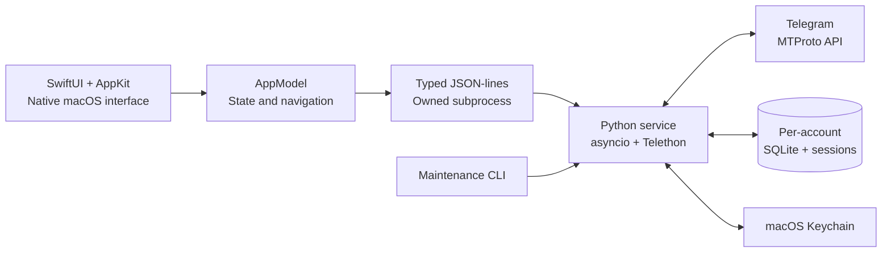

<div align="center">


# Unofficial Telegram Manager

### Your conversations. Your accounts. Your workspace.

**A native macOS Telegram workspace combining everyday messaging with deliberate, permission-aware group management.**

[](#requirements)
[](#requirements)
[](#under-the-hood)
[](#under-the-hood)
[](#project-status)

**[Get started](#get-started)** · **[Explore features](#the-experience)** · **[Architecture](#under-the-hood)** · **[Security](#built-with-boundaries)** · **[Roadmap](#whats-next)**

<sub>Independent third-party project · Not affiliated with Telegram</sub>

</div>

---

> [!IMPORTANT]
> **V3 · v0.4.0 · Development preview.** The native app and its backend compile and pass automated tests, but complete interactive UI acceptance is **not yet verified**. Builds currently depend on this repository's Python virtual environment. **No standalone installer or production-ready release is available.** See [validation evidence](docs/VALIDATION.md).

## One app. Two ways to work.

**Talk naturally. Manage intentionally.**

Telegram Manager brings a messaging-first desktop experience and an advanced workspace into one native Mac application. Browse supported conversations, move between isolated Telegram accounts, and use explicit, auditable workflows when interacting with managed groups.

| 💬 **Everyday messaging** | 🧭 **Advanced workspace** |
| :--- | :--- |
| Cached conversations, supported private/group history, Saved Messages, replies, local drafts, and account-scoped updates. | Group discovery, bounded permission inspections, approved destinations, reviewed composition, and persistent delivery records. |
| Familiar conversation navigation. | Controls designed to prevent accidental or unapproved delivery. |

### The experience

| Area | What you can do |
| :--- | :--- |
| **Chats** | Browse cached dialogs; load supported private and group message history; navigate with search and pagination. |
| **Accounts** | Add separate Telegram profiles, switch explicitly, disconnect, log out, or remove eligible local profiles with confirmation. |
| **Contacts** | Refresh Telegram contacts on demand and inspect supported profile metadata. |
| **Groups** | Discover joined groups, search and filter cached results, and review metadata freshness. |
| **Channels** | Browse cached channel identities; content access is intentionally restricted pending additional support. |
| **Saved Messages** | Access your supported personal Saved Messages conversation. |
| **Composer & Drafts** | Write Unicode text, import UTF-8 files, save drafts, and review exact destinations before delivery. |
| **Permissions** | Inspect posting evidence in bounded batches with explicit handling of unknown states and rate limits. |
| **Destinations** | Explicitly approve individual managed groups; approvals never authorize automatic sending. |
| **History & Activity** | Review persistent delivery/action records and a separate safe, session-only activity timeline. |

<details>
<summary><strong>What does “supported” mean?</strong></summary>

The current client supports private users, Saved Messages, and accessible basic/supergroup conversations within documented boundaries. Some message types, protected content, bots, and channels do **not** offer full content browsing or actions. Folder definitions are read-only metadata; broad media, calling, stories, and secret chats are not implemented. For the precise matrix, see [client feature boundaries](docs/CLIENT_FEATURES.md) and [Telegram feature feasibility](docs/TELEGRAM_FEATURE_FEASIBILITY.md).

</details>

## Designed for the Mac

Built with **SwiftUI + AppKit**, not a browser wrapper. The desktop interface uses native windows, keyboard-aware navigation, system appearance, and a responsive conversation layout. On supported macOS versions, selective Liquid Glass styling enhances native controls without replacing their behavior.

- **Messaging-first navigation** with an independent advanced workspace.
- **Adaptive conversation layout** for wide and narrow windows.
- **Local-first cached views** that avoid unnecessary Telegram requests.
- **Explicit loading, retry, and error states** rather than silently empty panels.
- **Light, dark, and system appearance** with native accessibility semantics.

> [!NOTE]
> **Real screenshots are coming after graphical acceptance.** The managed build environment could not complete reliable GUI capture. This README deliberately does not present mockups or fabricated screenshots as evidence. The [UI validation guide](docs/UI_VALIDATION.md) documents local capture procedures; accepted assets will live in `docs/assets/screenshots/`.

## Get started

### Requirements

| Requirement | Details |
| :--- | :--- |
| Mac | Apple Silicon (`arm64`), macOS **14+** |
| Build tools | Xcode with macOS SDK |
| Python | **3.13+**, installed in this repository's `.venv` |
| Telegram | Your own Telegram account and [API application credentials](https://my.telegram.org) |

### 1 · Build from source

```bash
git clone https://github.com/NipunChamodya/Telegrame-automator.git
cd Telegrame-automator

python3 -m venv .venv
.venv/bin/python -m pip install -e '.[dev]'

./macos/build.sh
open macos/build/Build/Products/Debug/TelegramManager.app
```

Already working from the original project folder?

```bash
cd ~/Desktop/TelegramManager
./macos/build.sh
open macos/build/Build/Products/Debug/TelegramManager.app
```

> [!CAUTION]
> **Quit the CLI before launching the desktop app.** The application starts and owns its Python backend. Do not start a second backend manually, and never delete a session or lock file to bypass a reported ownership conflict.

### 2 · Connect your Telegram account

1. Open **Accounts → Add Account** (or **Connect** on first launch).
2. Obtain an **API ID** and **API hash** from [Telegram's developer portal](https://my.telegram.org) → **API development tools**.
3. Enter your phone number with its country code.
4. Enter the verification code delivered by Telegram.
5. Complete two-step verification if prompted.
6. Verify the account identity shown by the app.

Adding a profile does **not** approve any destination or send any messages. Additional accounts use isolated local storage; switching accounts invalidates prior message previews and send confirmations.

**Account actions:** **Disconnect** keeps the local session; **Log Out** requests remote session invalidation; **Remove Local Data** is a separate confirmed action for eligible profiles. See [multi-account behavior](docs/MULTI_ACCOUNT.md).

### 3 · Explore the workspace

Open **Chats** to browse supported conversations. Use **Groups** to discover joined groups and **Permissions** to inspect available posting evidence. When you choose to manage delivery to a group, approve that destination explicitly and review each message before confirming it.

**Posting permission is not consent to advertise or send unsolicited messages.** No newly discovered group is automatically approved or messaged.

## Built with boundaries

Security is part of the workflow—not an optional mode.

| Boundary | Implementation |
| :--- | :--- |
| **Account isolation** | Separate private profile directories, SQLite state, sessions, and Keychain namespaces. |
| **Credential handling** | macOS Keychain for API credentials; no plaintext configuration fallback. |
| **Local IPC** | Typed, bounded JSON-lines messages over owned subprocess pipes; no HTTP server. |
| **Managed delivery** | Explicit group approval, fresh account/permission checks, exact confirmation, and persistent deduplication. |
| **Uncertain outcomes** | No automatic retries for uncertain sends, edits, or deletes. |
| **Rate limits** | FloodWait deadlines are respected and persisted; no evasion or uncontrolled bulk sending. |
| **Local privacy** | Private file permissions and sanitized diagnostics; sensitive caches and backups still require protection. |

**Keep `.session` files private.** They are authentication credentials and must never be committed, uploaded, or included in screenshots. See [SECURITY.md](SECURITY.md) and [message action semantics](docs/MESSAGE_ACTIONS.md).

## Under the hood



| Layer | Technology | Responsibility |
| :--- | :--- | :--- |
| Desktop | **Swift, SwiftUI, AppKit** | Native UI, windows, menus, accessibility, file dialogs |
| Application bridge | **Typed subprocess IPC** | Request/response transport, events, lifecycle, cancellation |
| Telegram service | **Python 3.13+, asyncio, Telethon 1.45.x** | Authentication, dialogs, messages, permissions, updates |
| Persistence | **SQLite** | Cached state, drafts, approvals, ledgers, cooldowns |
| Credentials | **macOS Keychain** | Account-scoped API secrets |
| Verification | **Pytest, unittest, XCTest** | Mocked backend, IPC, account, and native behavior tests |

No Electron, webview-based application shell, or unauthenticated local web server is required. Architecture details: [ARCHITECTURE.md](docs/ARCHITECTURE.md) · [IPC.md](docs/IPC.md) · [backend lifecycle](docs/BACKEND_LIFECYCLE.md).

## Project status

**Current preview:** `v0.4.0` · **V3**

The latest supplied project report records:

| Check | Result |
| :--- | :--- |
| Python | **299 tests + 133 subtests passed** |
| Native Swift | **86 XCTest tests passed** |
| Debug / Release | **Builds and strict signatures passed** |
| Interactive GUI acceptance | **Unverified in managed environment** |
| Screenshot capture | **Not completed** |
| Live Telegram acceptance | **Not performed in automated development** |
| Standalone distribution | **Not ready** — project `.venv` still required |

> [!WARNING]
> Passing tests and a successful build do **not** prove that every screen launches and behaves correctly on a real Mac. The managed environment reported `testmanagerd` error **159** and Launch Services **-10827** / process exit **-6**. Follow [VALIDATION.md](docs/VALIDATION.md) and [UI_VALIDATION.md](docs/UI_VALIDATION.md) for evidence and local acceptance steps.

### Run checks locally

```bash
.venv/bin/python -m pytest -q
.venv/bin/python -m compileall -q main.py src tests scripts
./macos/test.sh
./macos/build.sh Debug
./macos/build.sh Release
```

Use fixtures and isolated test storage; automated tests must not send live Telegram messages.

## What's next

| Stage | Focus |
| :--- | :--- |
| **Now · Acceptance** | Verify interactive launch, complete screenshot matrix, fix remaining UI issues, test accessibility and real-account flows with explicit authorization. |
| **Next · Distribution** | Bundle a verified Python runtime, sign/notarize the release, build a DMG, and validate on a clean Mac. |
| **Later · Messaging depth** | Expand supported media and actions, profile photo caching, synchronized folders, and applicable sponsored-content handling. |
| **Ongoing · Quality** | Benchmark startup, memory, responsiveness, and live Telegram behavior without overstating results. |

These are engineering goals, not promised release dates. See the [V3 delivery report](docs/V3_REPORT.md) and [full UI audit](docs/FULL_UI_AUDIT.md).

## Troubleshooting

<details>
<summary><strong>“Another instance is running”</strong></summary>

Quit the known competing CLI or desktop instance, open **View Diagnostics**, then use the app's reconnect action. Do **not** delete `manager.lock`, session files, or databases to silence the error. Read [BACKEND_LIFECYCLE.md](docs/BACKEND_LIFECYCLE.md).

</details>

<details>
<summary><strong>The app does not open</strong></summary>

Confirm Xcode, the signed build, and the repository's Python virtual environment are available. Follow [desktop diagnostics](docs/DESKTOP.md) and [UI validation](docs/UI_VALIDATION.md). Do not reset your account data as a first step.

</details>

<details>
<summary><strong>Groups show “Unknown” permissions</strong></summary>

Discovery intentionally gathers lightweight metadata. Run an explicit bounded permission inspection. Hidden group moderation rules may remain unknown even after inspection.

</details>

<details>
<summary><strong>Telegram requests a wait period</strong></summary>

Respect the saved FloodWait deadline. Do not repeatedly reconnect or retry to evade Telegram limits.

</details>

For more: [User guide](docs/USER_GUIDE.md) · [CLI guide](docs/CLI_GUIDE.md) · [Desktop setup](docs/DESKTOP.md).

## Documentation

| Guide | Covers |
| :--- | :--- |
| [User guide](docs/USER_GUIDE.md) | Setup, account connection, and everyday workflows |
| [Architecture](docs/ARCHITECTURE.md) | Components, storage, and service design |
| [IPC protocol](docs/IPC.md) | Native-to-Python communication |
| [Multi-account model](docs/MULTI_ACCOUNT.md) | Profile isolation and account lifecycle |
| [Client feature boundaries](docs/CLIENT_FEATURES.md) | Supported and intentionally unavailable features |
| [Security policy](SECURITY.md) | Privacy controls and vulnerability reporting |
| [Validation](docs/VALIDATION.md) | Automated checks and unresolved acceptance gates |
| [UI validation](docs/UI_VALIDATION.md) | Graphical testing and screenshot capture |
| [Contributing](CONTRIBUTING.md) | Development and testing conventions |

## Contributing

Bug reports, reproducible UI issues, documentation improvements, and well-scoped contributions are welcome. Start with [CONTRIBUTING.md](CONTRIBUTING.md). **Never include phone numbers, API hashes, session files, private chats, or account databases in an issue.**


## 📄 License

Copyright © 2026 Nipun Chamodya Karunarathna.

This project is licensed under the MIT License.
See the [LICENSE](LICENSE) file for details.

Unofficial Telegram Manager is an independent
third-party application and is not affiliated
with or endorsed by Telegram.

---

<div align="center">

**Crafted for macOS. Built with explicit control.**

Developed by **[Nipun Chamodya](https://github.com/NipunChamodya)**

[Repository](https://github.com/NipunChamodya/Telegrame-automator) · [Report an issue](https://github.com/NipunChamodya/Telegrame-automator/issues) · [Read the docs](docs/USER_GUIDE.md)

<sub>Unofficial Telegram Manager is an independent project and is not endorsed by or affiliated with Telegram.</sub>

</div>
